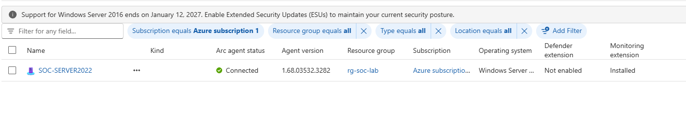
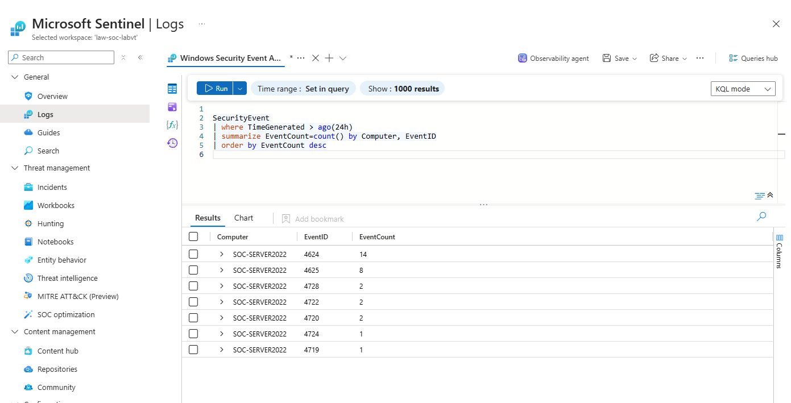
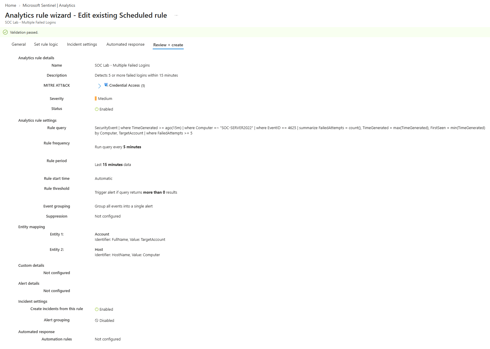
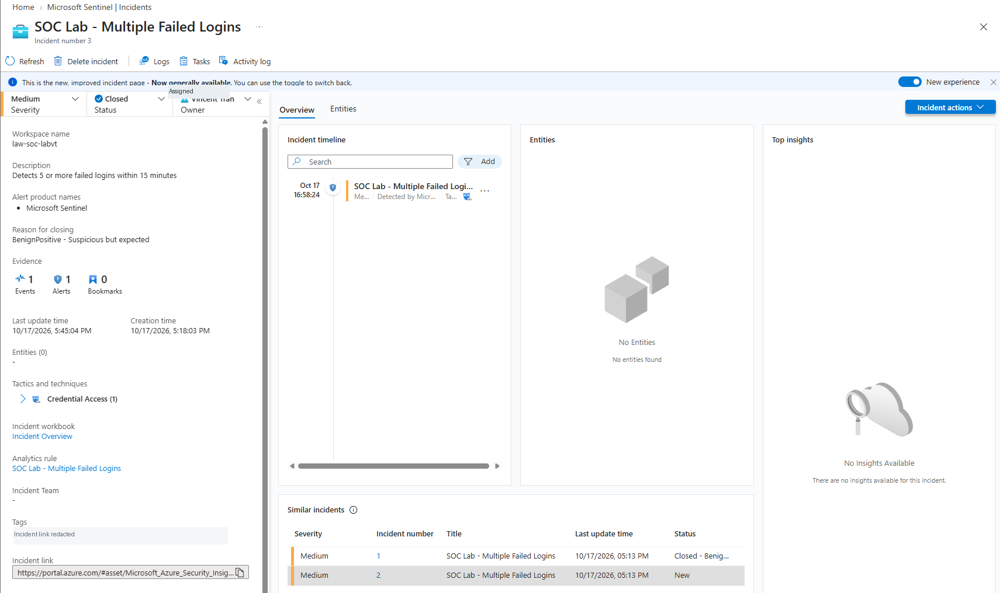

# Microsoft Sentinel SOC Lab — Cloud Security & Detection Engineering

**Part 1: Building and operating a cloud-connected SOC lab**  
**Status:** Completed lab deployment, detection testing, and incident triage.  
**Part 2 (planned):** Kali Linux purple-team simulation and defensive validation.

## Overview

I built a hands-on SOC lab to practice collecting Windows security telemetry, investigating authentication activity with Kusto Query Language (KQL), creating Microsoft Sentinel analytics rules, and triaging the incidents they generate.

This is a **personal, authorized test environment**. The failed login activity described here was intentionally generated against a disposable lab account; it was **not a real-world compromise**.

## Project highlights — actual lab evidence

The following screenshots are from my own lab, not sample Azure dashboards. They document the cloud connection, collected security events, the scheduled detection rule, and a tested incident.

<table>
<tr>
<td width="50%"><strong>1. Azure Arc-connected Windows Server</strong><br/></td>
<td width="50%"><strong>2. Windows Security Events in Log Analytics</strong><br/></td>
</tr>
<tr>
<td width="50%"><strong>3. Scheduled Sentinel detection rule</strong><br/></td>
<td width="50%"><strong>4. Simulated incident investigation</strong><br/></td>
</tr>
</table>

**Additional evidence:** [Detailed failed-login KQL investigation](screenshots/03-Failed-Login-Investigation.png) · [Account and host entity mapping](screenshots/06-Entity-Mapping.png)

## Skills demonstrated

**Cloud monitoring:** Azure Arc, Azure Monitor Agent, Data Collection Rules, Log Analytics  
**SOC operations:** Microsoft Sentinel, incident triage, benign-positive classification  
**Detection engineering:** KQL, scheduled analytics rules, thresholds, alert review  
**Windows security:** Security Event IDs, authentication failures, logon investigations

## Architecture

```text
Windows Server 2022 VM (VMware Workstation)
    |
    | Windows Security Event Log
    v
Azure Arc + Azure Monitor Agent (AMA)
    |
    v
Data Collection Rule (DCR)
    |
    v
Azure Log Analytics Workspace
    |
    v
Microsoft Sentinel
    |-- KQL investigation
    |-- Scheduled analytics detection
    `-- Incident triage and closure
```

The virtual machine is connected to Azure through **Azure Arc**. An Azure Monitor Agent configuration sends selected Windows events to a Log Analytics workspace, where Microsoft Sentinel is enabled.

## Technology

- Microsoft Sentinel, Azure Arc, Azure Monitor Agent, Log Analytics, Data Collection Rules
- Windows Server 2022, VMware Workstation
- Kusto Query Language (KQL), Windows Security Event Logs
- MITRE ATT&CK: **T1110 — Brute Force** (technique reference for the repeated failed-authentication scenario, not proof of an actual attacker)

## What I implemented

1. Deployed a Windows Server 2022 evaluation VM in VMware Workstation.
2. Onboarded the VM to Azure Arc and configured Windows Security event collection using AMA and a DCR.
3. Queried Windows authentication and account activity in Log Analytics with KQL.
4. Created a scheduled Sentinel analytics rule named **SOC Lab - Multiple Failed Logins**, evaluating a 15-minute window and alerting on five or more failed logons for the same account.
5. Generated controlled incorrect-password attempts against the disposable `soc-test` account.
6. Verified Windows Security Event **4625** (failed logon), reviewed the target account and logon details, and confirmed Sentinel created incidents.
7. Investigated and closed authorized test incidents as **Benign Positive — Suspicious but Expected**.

## Selected investigation findings

| Signal | Observation |
|---|---|
| Windows Event ID | **4625** — failed logon |
| Test account | `SOC-SERVER2022\soc-test` |
| Logon type | **2** — interactive |
| Source address in recorded local event | `::1` — loopback |
| Related authentication detail | Event **4776** with incorrect-password code `0xC000006A` |
| Detection threshold | **5 failures within 15 minutes** |
| Outcome | Sentinel incident generated from a deliberate, authorized test; triaged as benign positive |

**Scope note:** These were controlled authentication failures. They do not demonstrate a successful brute-force compromise or external intrusion.

## KQL queries

- [Windows security event counts](kql/security-event-overview.kql)
- [Failed-login investigation](kql/failed-login-investigation.kql)
- [Scheduled detection: multiple failed logins](kql/multiple-failed-logins-detection.kql)

The queries are illustrative versions of those used in the lab and may need adjustment for another workspace or server name.

## Incident write-up

Read [Simulated Failed-Login Incident](investigations/simulated-failed-logins.md) for the alert trigger, investigation, interpretation, and outcome.

## Evidence

The lab screenshots are being prepared for public upload with sensitive account, subscription, tenant, and resource identifiers removed. Add only sanitized evidence to [screenshots](screenshots/README.md).

Suggested proof points:
- Azure Arc server showing connected status
- KQL SecurityEvent results
- Investigated failed-logon events
- Sentinel scheduled analytics rule
- Incident details and closure classification

## Lessons learned

- Cloud SIEM deployments depend on correct event auditing, AMA and DCR association, and workspace ingestion.
- A Windows event existing locally does not prove it was ingested into Sentinel.
- Alert severity and incident classification require analyst review; a simulated trigger should not be reported as an actual attack.
- KQL detection thresholds and scheduling affect alert volume and duplicate incidents.
- Cloud SIEM work involves maintaining telemetry coverage **and** investigating the meaning of alerts.

## Next phase: Purple-team validation

I also established a separate lab network to test the Windows Server VM from a Kali Linux MacBook. Early Nmap reconnaissance observed filtered Windows service ports, and Windows locally recorded blocked network connections as **Event 5157**. Those observations are **not part of a completed exploitation or Sentinel network-detection claim**. I will document any future controlled exploitation and SIEM validation separately after testing is complete.

## Safety and costs

This lab uses owned/authorized systems only. No real users or production accounts were targeted. Azure ingestion and retention may incur charges; restrict event collection and shut down unused lab resources.

---
**Portfolio focus:** Cloud Security | SOC Operations | SIEM | Detection Engineering | KQL | Incident Investigation
